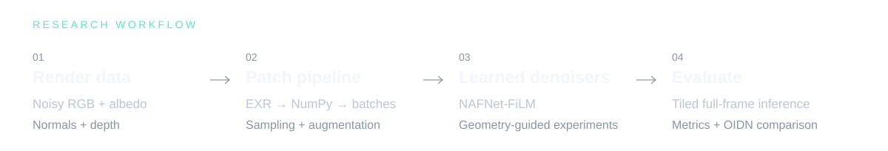
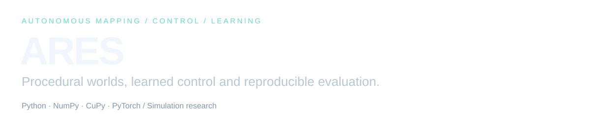
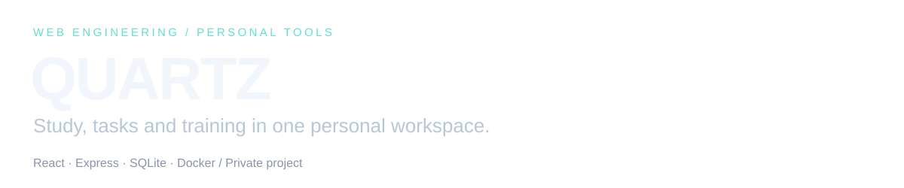

<picture>
  <source media="(prefers-color-scheme: light)" srcset="assets/research-header-light.svg" />
  
</picture>

  <strong>Machine learning · Computer graphics · Systems that ship</strong> 
  <a href="#primary-project--hygi-rendering">Denoising research</a> &nbsp; / &nbsp;
  <a href="#ares--simulation-learning-and-flight-control">ARES</a> &nbsp; / &nbsp;
  <a href="#maverick--language-meets-spatial-reasoning">Maverick</a> &nbsp; / &nbsp;
  <a href="#engineering-beyond-the-model">Engineering</a>

I’m **Robin Chaillou**, a developer working at the intersection of machine learning and computer graphics. My main project is collaborative **Monte Carlo denoising research with [HyGI-Rendering](https://github.com/HyGI-Rendering)**. I also build robotics software and web tools—from the numerical pipeline to the interface people actually use.

## Primary project · HyGI-Rendering

### Better images from fewer samples.

Rendering a clean image with Monte Carlo methods is expensive. Render fewer samples and you get noise; denoise too aggressively and you lose the structure you wanted to preserve. Our research explores how **learned image restoration and auxiliary geometry** can work together to reconstruct low-sample renders.

**This is my largest ongoing project.** It connects render-data preparation, model design, training infrastructure and full-frame evaluation in one research workflow.

> **Private research · Paper in preparation.** The implementation and manuscript remain private while the research develops. This overview covers our current research direction and implemented workflow.

<picture>
  <source media="(prefers-color-scheme: light)" srcset="assets/research-workflow-light.svg" />
  
</picture>

| Research area | Implementation |
| :--- | :--- |
| **Geometry-aware learning** | Noisy color is paired with albedo, surface normals and depth. The model code includes a NAFNet backbone with project-specific FiLM conditioning, plus geometry-guided architecture and loss experiments. |
| **Experimental data pipeline** | Multi-layer EXR is normalized into NumPy data, sampled into patches and assembled into training batches. Queued workers, Poisson-disk sampling and augmentation connect the render dataset to the training loop. |
| **Traceable training** | PyTorch, mixed precision, named presets, learning-rate scheduling and atomic checkpoints. Resolved experiment settings and training state are recorded with the weights. |
| **Full-frame evaluation** | Tiled inference, per-frame metrics, Intel Open Image Denoise comparisons and worst-case inspection. Recorded validation comparisons guide the experiments; a publication benchmark is in preparation. |

**Why this work matters to me:** a useful model needs more than a promising loss curve. I’m interested in the entire path from render buffers to a result you can inspect, compare and reproduce. The research is collaborative; model and pipeline details will be presented with the paper when ready.

**Research stack:** Python · PyTorch · NumPy · OpenEXR · image restoration · numerical data processing

---

## ARES · Simulation, learning and flight control

**A research framework for autonomous indoor mapping, exploration and depth-based flight-policy learning.**

<a href="https://github.com/desboisGIT/ARES">
  <picture>
    <source media="(prefers-color-scheme: light)" srcset="assets/ares-banner-light.svg" />
    
  </picture>
</a>

ARES builds the experimental foundation for a drone that maps unfamiliar buildings: generated environments, sensor simulation, observed-space mapping, exploration baselines and learned flight control. The focus is on **measuring behavior under explicit contracts**, with frozen policies, separate scoring and retained failure evidence.

| Engineering area | What the repository contains |
| :--- | :--- |
| **Worlds and sensing** | Seeded furnished rooms, apartments and building floors; recorded occupancy-map import; CPU/CUDA depth simulation, noise models and calibration tools. Geometry-based dataset splits keep the same collision layout out of different partitions. |
| **Mapping and exploration** | Depth/gyro odometry, voxel mapping and a classical frontier-exploration baseline. A local first-person viewer supports keyboard/gamepad controls, mission logging and replay. |
| **Learned flight control** | Full rigid-body dynamics with a body-rate controller and motor lag. Differentiable BPTT training learns a bounded depth/state residual; PPO uses the same policy interface for comparison. |
| **Evaluation and safety research** | Independent scoring, frozen checkpoints and source hashes, held-out cohorts, and conditional stopping-tube/backup-controller work with documented assumptions and open gates. |

The [recorded Phase 4 waypoint comparison](https://github.com/desboisGIT/ARES/blob/main/reports/phase_4_gate.md) reports **1,000/1,000 successful simulation tasks** for the selected BPTT policy, with zero contacts or speed violations. PPO completed 994/1,000; the untrained controller reference also completed 1,000/1,000. These results establish the measured waypoint gate on that fixed cohort, without demonstrating learned superiority over the reference.

**Active simulation research.** The integrated shield gate, real captures and onboard measurements remain open. Physical flight performance has not been established. The source is publicly viewable with rights reserved; see the repository's license.

**[Explore ARES →](https://github.com/desboisGIT/ARES)** &nbsp; · &nbsp; **[Read the build plan →](https://github.com/desboisGIT/ARES/blob/main/docs/build_plan_v3.md)** &nbsp; · &nbsp; **[Inspect the evaluation evidence →](https://github.com/desboisGIT/ARES/blob/main/reports/phase_4_gate.md)**

**Stack:** Python · NumPy · SciPy · CuPy/CUDA · PyTorch · differentiable simulation

---

## Maverick · Language meets spatial reasoning

**An indoor drone simulation stack that turns natural-language missions into typed, executable skills.**

<a href="https://github.com/desboisGIT/Maverick">
  <picture>
    <source media="(prefers-color-scheme: light)" srcset="https://raw.githubusercontent.com/desboisGIT/Maverick/main/assets/banner-light.svg" />
    
  </picture>
</a>

An operator asks it to explore an apartment, go to a room or search for an object. The stack connects an agent to mapping, scene memory and navigation; a **TypeScript / three.js Mission Console** shows the camera, voxel map, path and conversation.

| Engineering challenge | What the repository contains |
| :--- | :--- |
| Turn intent into motion | Typed agent tools and a skill executive; flight-critical control remains on PX4 |
| Reason about unfamiliar spaces | Depth-based voxel mapping, frontier exploration and room/object memory |
| Test without confusing tuning with evaluation | Generated apartments, scenario runners, a separate scoring referee and a seed ledger |
| Make iteration affordable | A kinematic simulator that reuses real stack modules, calibrated against 60 Gazebo tuning runs |
| Make behavior inspectable | A browser console and a standalone scripted mock demo |

**Public simulation prototype.** Hardware flight and the full voice interface are future work. The mock demo is explicitly synthetic.

**[Explore the code →](https://github.com/desboisGIT/Maverick)** &nbsp; · &nbsp; **[Try the console demo →](https://github.com/desboisGIT/Maverick#try-the-mission-console)** &nbsp; · &nbsp; **[Read the simulator calibration →](https://github.com/desboisGIT/Maverick/blob/main/docs/kinsim.md)**

**Stack:** Python · ROS 2 · PX4 · Gazebo · TypeScript · three.js · Docker

---

## Engineering beyond the model

<picture>
  <source media="(prefers-color-scheme: light)" srcset="assets/quartz-banner-light.svg" />
  
</picture>

### Quartz · A personal workspace for study, training and agents

**[prepa.chaillou.work](https://prepa.chaillou.work)** is my authenticated daily-use application. It brings together a study platform, a detailed workout tracker, recurring tasks and a scoped MCP server, built with **React, Express and SQLite**.

- **MCP integration:** agents can read authorized context, manage tasks and workout templates, start sessions, record user-supplied performances, and import course PDFs through supported tools. OAuth with PKCE, explicit scopes and revocable connections keep permissions under the user's control.
- **Advanced workout tracking:** editable routines, weights/reps/RPE, warm-up and drop-set types, rest timers, notes and session history. Per-exercise load/repetition charts, comparisons between sessions and training summaries make progression inspectable.
- **Study workflow:** a searchable course library, PDF reader, timed exercises, chapter mastery, FSRS flashcards, a study journal and Pomodoro. Recurring tasks, weighted completion tracking, goals and deadlines sit alongside study and training.
- **Offline and reliable writes:** the prepared app can reopen offline on a previously authenticated device. Durable queues, revision checks and idempotent operation receipts protect supported task and workout changes from lost responses and duplicate submissions.

Docker, Caddy HTTPS and automated deployment support the live installation. The repository and its teaching material, class details and personal tracking data stay private.

### How I approach projects

**Build the full path:** data, logic, interface and deployment. **Make behavior visible:** inspectable outputs, logs and failure cases. **Keep evidence scoped:** simulation, tuning and validation answer different questions.

<strong>Current focus: geometry-informed denoising, reproducible research and autonomous systems.</strong>

