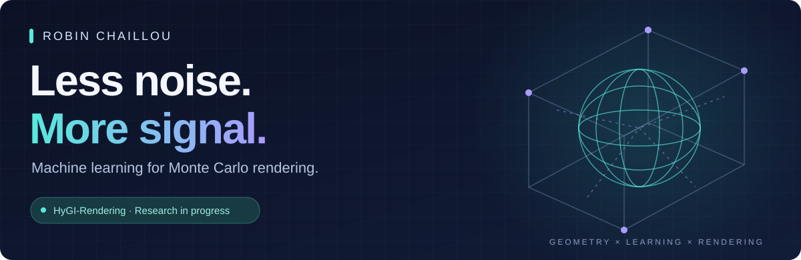
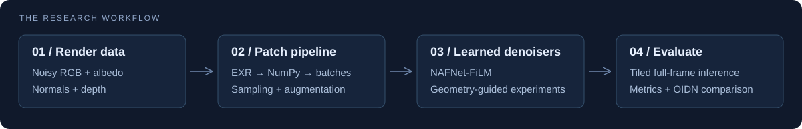

  

  <strong>Machine learning · Computer graphics · Systems that ship</strong> 
  <a href="#primary-project--hygi-rendering">Denoising research</a> &nbsp; / &nbsp;
  <a href="#maverick--language-meets-spatial-reasoning">Maverick</a> &nbsp; / &nbsp;
  <a href="#engineering-beyond-the-model">Engineering</a>

I’m **Robin Chaillou**, a developer working at the intersection of machine learning and computer graphics. My main project is collaborative **Monte Carlo denoising research with [HyGI-Rendering](https://github.com/HyGI-Rendering)**. I also build robotics software and web tools—from the numerical pipeline to the interface people actually use.

## Primary project · HyGI-Rendering

### Better images from fewer samples.

Rendering a clean image with Monte Carlo methods is expensive. Render fewer samples and you get noise; denoise too aggressively and you lose the structure you wanted to preserve. Our research explores how **learned image restoration and auxiliary geometry** can work together to reconstruct low-sample renders.

**This is my largest ongoing project.** It connects render-data preparation, model design, training infrastructure and full-frame evaluation in one research workflow.

> **Private research · Paper in preparation.** The implementation and manuscript remain private while the research develops. This overview covers our current research direction and implemented workflow.

<table>
<tr>
<td width="50%" valign="top">

#### Geometry-aware learning

We work with noisy color alongside **albedo, surface normals and depth**. The model code includes a NAFNet backbone with project-specific **FiLM conditioning**, plus geometry-guided architecture and loss experiments.

The goal is practical: use information from the renderer to help distinguish sampling noise from actual image structure.

</td>
<td width="50%" valign="top">

#### A pipeline built for experiments

Multi-layer **EXR → normalized NumPy data → sampled patches → training batches**. Queued workers, Poisson-disk sampling and augmentation connect the render dataset to the training loop.

The data path is part of the research: sampling, normalization and input contracts all affect what a model learns.

</td>
</tr>
<tr>
<td width="50%" valign="top">

#### Training that can be traced

**PyTorch**, mixed precision, named experiment presets, learning-rate scheduling and atomic checkpoint saves. Checkpoints record resolved settings and training state so an experiment can be inspected after its configuration changes.

</td>
<td width="50%" valign="top">

#### Evaluate the whole image

Tiled full-frame inference, per-frame metrics, **Intel Open Image Denoise** comparisons and worst-case inspection. Recorded validation comparisons guide the experiments; a reproducible publication benchmark is still in preparation.

</td>
</tr>
</table>

**Why this work matters to me:** a useful model needs more than a promising loss curve. I’m interested in the entire path from render buffers to a result you can inspect, compare and reproduce. The research is collaborative; model and pipeline details will be presented with the paper when ready.

**Research stack:** Python · PyTorch · NumPy · OpenEXR · image restoration · numerical data processing

---

## Maverick · Language meets spatial reasoning

**An indoor drone simulation stack that turns natural-language missions into typed, executable skills.**

An operator asks it to explore an apartment, go to a room or search for an object. The stack connects an agent to mapping, scene memory and navigation; a **TypeScript / three.js Mission Console** shows the camera, voxel map, path and conversation.

| Engineering challenge | What the repository contains |
| :--- | :--- |
| Turn intent into motion | Typed agent tools and a skill executive; flight-critical control remains on PX4 |
| Reason about unfamiliar spaces | Depth-based voxel mapping, frontier exploration and room/object memory |
| Test without confusing tuning with evaluation | Generated apartments, scenario runners, a separate scoring referee and a seed ledger |
| Make iteration affordable | A kinematic simulator that reuses real stack modules, calibrated against 60 Gazebo tuning runs |
| Make behavior inspectable | A browser console and a standalone scripted mock demo |

**Public simulation prototype.** Hardware flight and the full voice interface are future work. The mock demo is explicitly synthetic.

**[Explore the code →](https://github.com/desboisGIT/Maverick)** &nbsp; · &nbsp; **[Try the console demo →](https://github.com/desboisGIT/Maverick#try-the-mission-console)** &nbsp; · &nbsp; **[Read the simulator calibration →](https://github.com/desboisGIT/Maverick/blob/main/docs/kinsim.md)**

**Stack:** Python · ROS 2 · PX4 · Gazebo · TypeScript · three.js · Docker

---

## Engineering beyond the model

<table>
<tr>
<td width="50%" valign="top">

#### Carnet de prépa · Private deployed app

A personal study platform built with **React, Express and SQLite**: course navigation, exercises, FSRS spaced repetition and study tracking. Docker, HTTPS and automated deployment support everyday use.

Its repository stays private to protect teaching material and class information. The public overview deliberately excludes those contents.

</td>
<td width="50%" valign="top">

#### How I approach projects

- **Build the full path:** data, logic, interface and deployment.
- **Make behavior visible:** inspectable outputs, logs and failure cases.
- **Keep evidence scoped:** simulation, tuning and validation answer different questions.
- **Use the tool that fits:** Python for numerical work; TypeScript and JavaScript for interfaces and services.

</td>
</tr>
</table>

<strong>Current focus: geometry-informed denoising, reproducible research and autonomous systems.</strong>

